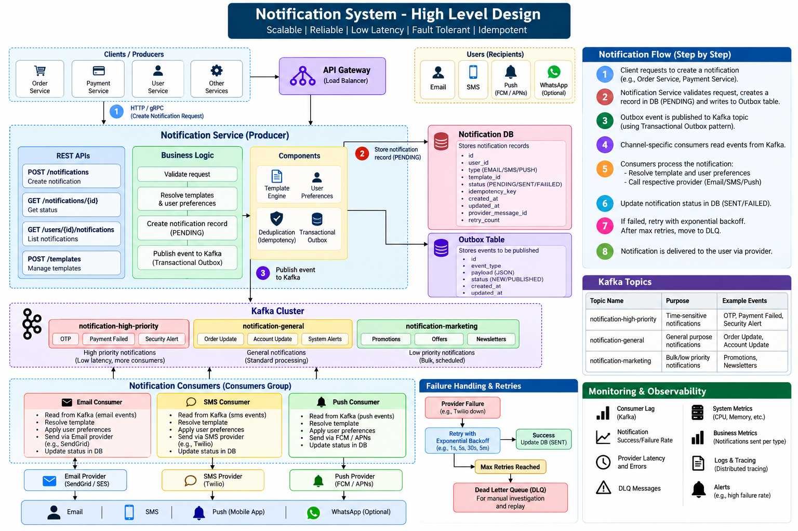

# Notification System 



> **Goal:** Design a reliable, scalable system that sends notifications
> through email, SMS, push, and in-app channels.
>
> **Interview target:** Be able to explain the design, justify
> trade-offs, and answer failure-scenario questions---not just draw
> boxes.

## 1. Problem statement

Build a notification platform that receives business events (for
example, `ORDER_SHIPPED` or `PAYMENT_FAILED`) and delivers notifications
to users through one or more channels.

Example: - Order shipped → email + push - Payment failed → SMS + email -
OTP requested → SMS, with a strict latency target

## 2. Requirements

### Functional requirements

1.  Send notifications through email, SMS, push, and in-app channels.
2.  Support user preferences and opt-outs.
3.  Support reusable, versioned templates.
4.  Track notification status and delivery attempts.
5.  Retry transient failures and route exhausted failures to a
    dead-letter queue (DLQ).
6.  Support idempotency to reduce duplicate notifications.
7.  Support scheduled notifications if required.
8.  Provide APIs to list in-app notifications and mark them as read.

### Non-functional requirements

-   **Scalability:** Scale service instances and consumers horizontally.
-   **Availability:** Avoid a single application instance or broker
    being a single point of failure.
-   **Durability/reliability:** Persist requests/events so a process
    crash does not silently lose work.
-   **Latency:** Give OTP/security alerts higher priority than marketing
    messages.
-   **Fault tolerance:** Handle provider outages, timeouts, throttling,
    and network errors.
-   **Idempotency:** Make repeated processing safe and reduce duplicate
    side effects.
-   **Observability:** Track latency, failures, retries, consumer lag,
    and DLQ volume.
-   **Security/privacy:** Protect PII, tokens, phone numbers, email
    addresses, and notification content.

## 3. High-level architecture

``` text
Business Services (Order, Payment, Account)
                 |
                 v
          API Gateway / Auth
                 |
                 v
        Notification API Service
          |       |        |
          |       |        +--> Redis (optional: cache, rate limits)
          |       +-----------> MySQL/PostgreSQL
          |                     (notification metadata,
          |                      preferences, templates, outbox)
          |
          v
     Transactional Outbox Publisher
                 |
                 v
              Kafka
       (topics / partitions)
          |       |       |
          v       v       v
       Email     SMS     Push
      Consumer Consumer Consumer
          |       |       |
          v       v       v
      Provider  Provider FCM/APNs
          \       |       /
           \      |      /
            Delivery-status updates
                     |
                     v
               Notification DB

In-app notifications can be stored in the DB and fetched by API.
WebSocket/SSE may be added for real-time in-app updates.
```

**Core flow:** Accept request/event → validate → check preferences →
persist notification and outbox event atomically → publish to Kafka →
channel consumer processes → call provider → record outcome.

The diagram is a starting point, not a requirement to use every
component. Keep the design as simple as the stated requirements allow.

## 4. Example request and APIs

### Create notification

`POST /v1/notifications`

``` json
{
  "userId": "U123",
  "eventType": "ORDER_SHIPPED",
  "channels": ["EMAIL", "PUSH"],
  "templateId": "ORDER_SHIPPED",
  "idempotencyKey": "order-O123-shipped",
  "data": {
    "orderId": "O123"
  }
}
```

Return `202 Accepted` when the request has been accepted for
asynchronous processing. Do not claim it has already reached the user.

Other possible APIs: -
`GET /v1/users/{userId}/notifications?cursor=...` -
`PATCH /v1/notifications/{notificationId}` --- mark as read -
`GET /v1/users/{userId}/preferences` -
`PUT /v1/users/{userId}/preferences`

Use authentication and authorization; callers must not be allowed to
send notifications on behalf of arbitrary users.

## 5. Data model (illustrative)

### Notification

-   `notification_id` (primary key)
-   `user_id`
-   `event_type`
-   `channel`
-   `template_id` / template version
-   `status` (`PENDING`, `PROCESSING`, `SENT_TO_PROVIDER`, `DELIVERED`,
    `FAILED`)
-   `priority`
-   `created_at`, `scheduled_at`
-   `attempt_count`, `last_error`
-   `idempotency_key`

A multi-channel request may create one delivery record per channel, for
example `(notification_id, channel)`.

### UserPreference

-   `user_id`
-   `event_type` or category
-   `channel`
-   `enabled`

### Template

-   `template_id`
-   `version`
-   `channel`
-   `locale`
-   `content` / variables

### OutboxEvent

-   `event_id`
-   `aggregate_id` / `notification_id`
-   `event_type`
-   `payload`
-   `created_at`
-   `published_at`

Add appropriate unique constraints and indexes. For large notification
history, partition/archive old data or consider a distributed store
after measuring the workload.

## 6. Why asynchronous processing?

Synchronous design:

``` text
API -> email/SMS provider -> API response
```

The API request remains tied to provider latency and failures. A slow
provider can exhaust request threads and make the API unavailable.

Asynchronous design:

``` text
API -> durable event/queue -> worker -> provider
```

The API can respond quickly after accepting the request. Workers scale
independently, and a queue absorbs traffic spikes. The trade-off is that
delivery is eventually consistent, so the API should return an
accepted/pending state rather than promise immediate delivery.

## 7. Kafka concepts needed for this HLD

-   **Topic:** Named stream of records, e.g. `notification-requests`.
-   **Partition:** An ordered subset of a topic; enables parallelism.
-   **Producer:** Publishes records.
-   **Consumer:** Reads and processes records.
-   **Consumer group:** Consumers cooperating on a topic; each partition
    is assigned to at most one consumer in a group at a time. Different
    groups can independently read the same events.
-   **Offset:** A consumer's position in a partition.
-   **Replay:** Read retained records again by resetting offsets or
    using a new consumer group with an appropriate starting offset.
    Replay is possible only while records remain retained.
-   **Consumer lag:** How far behind the end of a partition a consumer
    group is.
-   **Retention:** How long/large Kafka keeps records, regardless of
    whether a consumer read them.
-   **Replication:** Copies of partitions across brokers help tolerate
    broker failure.

### Why Kafka?

Choose Kafka when multiple independent consumers need events, event
replay/retention matters, throughput is high, partition-based ordering
is useful, or the organization already operates an event-streaming
platform.

### Why not always Kafka?

Kafka adds concepts and operational complexity. If the problem is simply
"put a job in a queue and let one worker process it," a managed queue
such as AWS SQS may be simpler.

## 8. Kafka vs AWS SQS vs SNS + SQS

  -----------------------------------------------------------------------
  Need                    Suitable option         Why
  ----------------------- ----------------------- -----------------------
  Background job; one     SQS                     Managed queue
  worker should process                           abstraction; simple
  each message                                    operations

  Multiple independent    Kafka                   Consumer groups,
  consumers need the same                         offsets, retention,
  event, replay, retained                         replay
  event stream                                    

  AWS-native fan-out to   SNS + SQS               SNS fans out; each SQS
  independent worker                              queue holds work for
  queues                                          its own subscriber

  Ordered messages in a   SQS FIFO or Kafka       Different ordering
  queue                   partitioning            scopes and trade-offs
  -----------------------------------------------------------------------

Do not say "Kafka scales but SQS does not." Both can scale. The
distinction is the workload and required semantics.

**Interview answer:** "If this is primarily a background work queue in
AWS, I would consider SQS first for simplicity. I would choose Kafka
when we need a retained event stream, replay, multiple independent
consumer groups, or partition-based ordering. For AWS-native fan-out,
SNS + SQS is also a strong option."

## 9. Reliability: retries, backoff, and DLQ

Not every error should be retried: - **Transient:** timeout, network
issue, provider `429`, provider `5xx` --- retry with backoff and
jitter. - **Permanent:** invalid email/phone, unsupported template,
invalid request --- mark failed or route for investigation instead of
retrying forever.

Example retry schedule (illustrative; tune to provider limits and
latency needs): - Attempt 1: immediately - Attempt 2: after 1 second -
Attempt 3: after 5 seconds - Attempt 4: after 30 seconds - Then route to
a DLQ or terminal failure workflow

Use bounded retries, exponential backoff, and jitter. Avoid hot-loop
retries that worsen an outage. A DLQ lets operators inspect, fix, and
selectively redrive failed messages.

## 10. Idempotency and duplicate delivery

Kafka/SQS processing is commonly at-least-once in practical designs: a
message can be delivered again after a crash or timeout.

Example: 1. Consumer calls email provider successfully. 2. Consumer
crashes before recording success/committing its offset. 3. The message
is processed again. 4. A duplicate email may be sent.

Mitigations: - Generate a stable idempotency key, such as
`order-O123-shipped-email`. - Enforce uniqueness in the database for the
logical notification/channel. - Track attempts and state transitions. -
Use provider-side idempotency keys where supported.

**Important:** A database check alone cannot guarantee exactly-once
external delivery. There is a failure window between the provider
accepting the request and your system recording that success. Explain
the limitation honestly.

## 11. Transactional Outbox (DB + Kafka consistency)

Problem: writing to the database and publishing to Kafka are two
separate operations.

Failure example: - Notification row saved successfully. - Kafka publish
fails. - The DB says the notification exists, but no worker receives it.

Solution: 1. In one DB transaction, write the notification/delivery rows
and an `OutboxEvent`. 2. A separate publisher/CDC process reads
unpublished outbox records and publishes them to Kafka. 3. Mark
published/track progress; make publication and consumers tolerant of
duplicates.

This avoids losing the event between the database write and Kafka
publication. The publisher may publish an event more than once, so
consumers still need idempotency.

## 12. Ordering and partition strategy

Kafka preserves order **within a partition**, not globally.

If events for the same order must be ordered, use `orderId` as the
message key. If per-user order matters, consider `userId`. Choose the
key based on the business ordering requirement.

Trade-off: a very hot key can create a hot partition. Also, external
providers may deliver messages at different speeds, so Kafka ordering
alone does not guarantee end-user delivery order across channels.

## 13. Priority, rate limits, and provider failover

### Priority

-   High: OTP, security alerts, payment failures
-   Medium: order updates
-   Low: marketing

Use separate topics/queues or isolated worker pools if low-priority
traffic could delay critical messages. Avoid overcomplicating the design
before requirements demand it.

### Rate limiting

Providers impose limits. Use token-bucket/leaky-bucket style limits and
per-provider concurrency controls; Redis can coordinate limits across
instances. Respect `429` and `Retry-After`.

### Provider failover

A provider router may switch providers for eligible transient failures.
Be careful: a timeout may occur after the provider accepted the message,
so blindly switching providers can cause duplicates. Use
idempotency/correlation where supported.

## 14. Scheduled and in-app notifications

### Scheduled

Store `scheduled_at` and use a scheduler/worker to publish due
notifications. At high scale, avoid a single worker scanning an
unbounded table every second; consider indexed time buckets,
partitioning, or a dedicated scheduling service.

### In-app

Persist notifications and expose paginated APIs. Add unread/read state.
WebSocket or Server-Sent Events can provide real-time updates if needed.

## 15. Storage and scaling choices

-   Start with PostgreSQL/MySQL for metadata, preferences, templates,
    and outbox transactions.
-   Use Redis for caching or distributed rate limiting where
    justified---not as the sole durable record.
-   Keep large notification history bounded through retention,
    partitioning, and archival.
-   Consider DynamoDB/Cassandra when measured write/read scale and
    access patterns justify a distributed NoSQL store.
-   Scale API instances behind a load balancer; scale consumers based on
    partition count, provider limits, and consumer lag.
-   More consumers than partitions in one consumer group do not create
    more parallelism for that topic.

## 16. Observability and security

### Metrics

-   accepted / sent / delivered / failed counts
-   end-to-end latency and queue wait time
-   provider error and throttling rate
-   retry count and DLQ depth
-   Kafka consumer lag
-   scheduled-notification delay

### Logs/tracing

Use `requestId`, `notificationId`, and `correlationId`. Avoid logging
full message bodies, OTPs, access tokens, or unnecessary PII.

### Security

-   Authenticate callers and authorize user/tenant scope.
-   Encrypt data in transit and at rest.
-   Protect device tokens, phone numbers, and email addresses.
-   Apply retention/deletion policies and consent/opt-out rules.
-   Limit access to DLQs because they may contain sensitive payloads.

## 17. Common interview failure scenarios

### A. API saves DB row but Kafka is unavailable

Use the transactional outbox. The event remains in the DB until it can
be published.

### B. Consumer crashes during processing

The message may be delivered again. Resume from the committed
offset/visibility-timeout flow, retry safely, and use idempotency.

### C. Provider succeeds but DB status update fails

A retry may send a duplicate. Use provider idempotency if supported and
clearly discuss the unavoidable external side-effect boundary.

### D. Provider is throttling

Reduce concurrency, honor retry hints, use backoff with jitter, and
isolate the provider's queue/worker pool.

### E. Consumer lag grows

Check incoming rate vs processing rate, provider latency, errors,
partition count, and worker capacity. Scale only when the bottleneck and
partition constraints permit it.

### F. Marketing campaign delays OTPs

Separate critical and bulk traffic into isolated queues/topics and
worker pools, with provider capacity reserved for critical messages if
required.

### G. Same event is published twice

Use a stable event/idempotency key and deduplicate at the logical
notification/channel level.

## 18. Interview walkthrough (use this order)

1.  Clarify channels, traffic, latency, delivery expectations, ordering,
    and scheduling.
2.  State functional and non-functional requirements.
3.  Estimate average/peak traffic and storage; state assumptions rather
    than inventing precision.
4.  Define APIs and data model.
5.  Draw the basic flow: API → durable queue/stream → channel workers →
    providers.
6.  Explain why you selected Kafka, SQS, or SNS + SQS.
7.  Cover DB/Kafka consistency with the transactional outbox.
8.  Cover retries, DLQ, idempotency, provider errors, and duplicate
    scenarios.
9.  Discuss partitioning, ordering, priority, rate limits, scaling, and
    observability.
10. State trade-offs and what you would defer until scale/requirements
    justify it.

## 19. Expected interview questions

### Requirements and architecture

1.  What are the functional and non-functional requirements?
2.  Why asynchronous processing?
3.  Why use a queue/stream instead of calling providers directly?
4.  How do you estimate throughput and storage?
5.  What should the API return: `200`, `201`, or `202`?

### Kafka and messaging

6.  What is a topic, partition, consumer group, and offset?
7.  What is replay, and when is it useful?
8.  How does Kafka scale consumers?
9.  How do you choose a partition key?
10. What happens when a consumer crashes?
11. What is consumer lag?
12. What are retention and replication?
13. Why Kafka instead of SQS?
14. When would SNS + SQS be a better fit?

### Reliability and consistency

15. How do you retry transient failures?
16. What is a DLQ?
17. How do you prevent duplicates?
18. Can you guarantee exactly-once email/SMS delivery?
19. What is the transactional outbox pattern?
20. What if DB save succeeds but Kafka publish fails?
21. What if the provider succeeds but the DB update fails?
22. How do you maintain ordering?

### Scaling and operations

23. How do you prevent marketing traffic from delaying OTPs?
24. How do you rate-limit provider calls?
25. How do you handle provider outages?
26. How do you monitor delivery health?
27. When would you move notification history to NoSQL?
28. How do you support scheduled and in-app notifications?

## 20. Final revision cheat sheet

Remember these linked ideas:

-   **Async queue/stream** → decouples API latency from provider
    latency.
-   **Kafka partitions** → parallelism and per-partition ordering.
-   **Consumer group** → independent consumer application/scaling unit.
-   **Offset + retention** → replay retained events.
-   **At-least-once** → duplicates are possible.
-   **Idempotency** → repeated processing should not repeat side effects
    when avoidable.
-   **Retry + exponential backoff + jitter** → recover from transient
    failures without overwhelming providers.
-   **DLQ** → isolate messages that exhausted retry policy.
-   **Transactional outbox** → avoid losing events between DB commit and
    Kafka publish.
-   **SNS + SQS** → AWS-native fan-out to independent durable work
    queues.
-   **Provider rate limits** → control concurrency and respect
    throttling.
-   **No "exactly once" promise for external delivery** → discuss
    provider support and failure windows.

### A concise answer to memorize

"I'd accept notification requests asynchronously, persist the request
and outbox event in one database transaction, and publish events to
Kafka. Channel-specific consumers would validate preferences, render
templates, apply rate limits, and call email/SMS/push providers. I'd use
bounded retries with backoff and jitter, a DLQ for exhausted failures,
and idempotency keys to reduce duplicate side effects. I'd isolate
high-priority notifications from bulk traffic, monitor latency and
consumer lag, and choose Kafka over SQS only when replay, retained event
streams, or multiple independent consumers justify its complexity. For
an AWS-native work-queue design, SQS or SNS + SQS may be simpler."

------------------------------------------------------------------------

*Study tip: First explain the basic architecture without notes. Then
practice the failure scenarios in Section 17; they reveal whether you
understand the design or have only memorized the diagram.*
